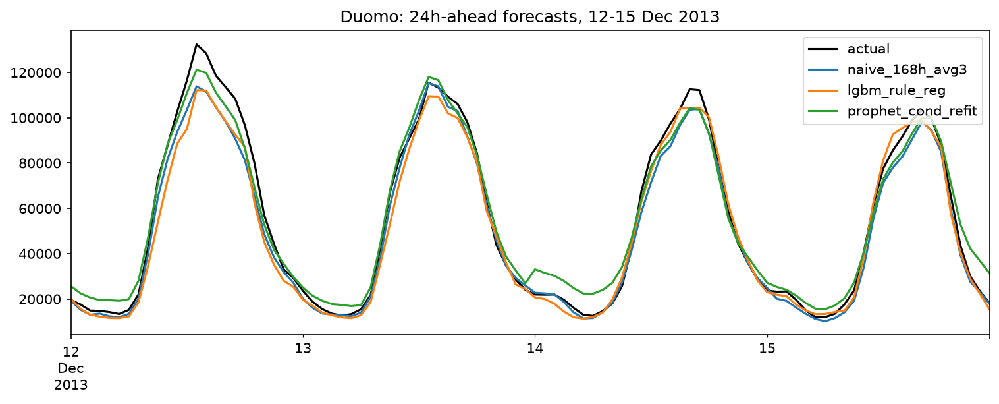
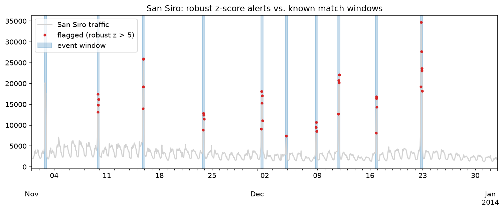

# Milan Telecom Traffic: Forecasting and Anomaly Detection

Day-ahead forecasting of hourly mobile internet traffic in central Milan, and detection of match-night surges around San Siro, using the Telecom Italia Milan dataset (1 Nov 2013 – 1 Jan 2014).

**Headline results**

- With about 30 days of training data, a three-week seasonal average (MAE 3,955; 7.3% of mean traffic) beat every learned model on an ordinary test window.
- A robust z-score detector found all 9 evaluable San Siro match nights with no false alarms; a forecast-residual detector found 6 of the 7 events both could score.

## Data

- **Source:** Telecom Italia Big Data Challenge, Milan (raw files via Kaggle `freckled/telecom`; grid map via `marcodena/mobile-phone-activity`). Values are normalized and unitless.
- **Processing:** 10-minute records summed to hourly internet traffic; timestamps converted from UTC to Europe/Rome. 1,488 hours per zone, no gaps.
- **Zones** (cells verified against the official grid GeoJSON):

| Zone | Cells | Role |
|---|---|---|
| Duomo | 3×3 block around 5060 | forecasting target |
| San Siro | 5636–5640, 5736–5740 | anomaly detection |
| Bocconi | 4460 | quiet reference zone |

San Siro was cross-checked with the data: the derby night (22 Dec) produced the largest surge in these cells (see `src/grid_selection.py`).

## Forecasting (Duomo, 24 h ahead)

Every model predicts the 24 hours of day D using data up to 23:00 of day D−1.

- **Features:** lags of 24, 48 and 168 h; rolling means shifted by 24 h; hour of day (sin/cos); day type; weekend and holiday flags. Weekday holidays follow the Sunday schedule, because the training window contains none.
- **Split:** train 8 Nov – 8 Dec, test 9–19 Dec (264 hours, no holidays), holiday stress test 20 Dec – 1 Jan.
- **Models:** seasonal-naive baselines, LightGBM (with a regularized variant), Prophet (default, and with separate daily profiles for working and off days). Refit variants retrain every test day.

| Model | MAE | RMSE | sMAPE (%) | MAE / mean (%) |
|---|---|---|---|---|
| naive 24 h | 6,875 | 9,805 | 16.3 | 12.6 |
| naive 168 h | 5,152 | 7,291 | 10.2 | 9.5 |
| **naive 3-week average** | **3,955** | **5,691** | **7.8** | **7.3** |
| LightGBM | 4,919 | 6,934 | 9.6 | 9.0 |
| LightGBM, no holiday rule | 4,861 | 6,879 | 9.5 | 8.9 |
| LightGBM, regularized | 4,774 | 6,623 | 9.9 | 8.8 |
| LightGBM, regularized, daily refit | 5,104 | 7,124 | 10.3 | 9.4 |
| Prophet, default, daily refit | 7,225 | 8,745 | 19.8 | 13.3 |
| Prophet, conditional, daily refit | 5,011 | 6,082 | 14.6 | 9.2 |



**Findings**

- LightGBM stays about 21–24% behind the three-week average. Regularization cut test MAE by 3% (8% in cross-validation).
- Separate working-day and off-day profiles improved Prophet by 31% (validated on 1–8 Dec before touching the test window). Prophet follows the peaks (lower RMSE than LightGBM) but over-predicts quiet night hours (higher sMAPE).
- Most of the error is the daily level: rescaling each day to its true mean removes about 45% of MAE for both LightGBM and the seasonal average, and the daily error correlates 0.96 with the week-over-week change (11 days, indicative). That rescaling is a diagnostic, not a forecast.
- Holiday stress test (20 Dec – 1 Jan): all models degrade sharply (MAE 15.7k–19.8k). LightGBM with calendar features (15.7k) is ahead of the seasonal average (19.8k), but this period was inspected during exploration, so treat it as indicative.

## Anomaly detection (San Siro)

**Events:** 10 matches played at San Siro in the window (home games of Milan and Inter, plus Italy–Germany), checked against match pages. 9 are evaluable; the detector needs 7 days of history.

| Date | Match | Max z |
|---|---|---|
| 2 Nov | Milan – Fiorentina | not evaluable (warm-up) |
| 9 Nov | Inter – Livorno | 8.4 |
| 15 Nov | Italy – Germany | 18.2 |
| 23 Nov | Milan – Genoa | 10.2 |
| 1 Dec | Inter – Sampdoria | 17.7 |
| 4 Dec | Inter – Trapani (Coppa Italia) | 6.1 |
| 8 Dec | Inter – Parma | 10.1 |
| 11 Dec | Milan – Ajax (Champions League) | 18.6 |
| 16 Dec | Milan – Roma | 16.5 |
| 22 Dec | Inter – Milan (derby) | 23.8 |

**Detectors**

- **A: rolling robust z-score** against the previous 168 hours (median and MAD, current point excluded).
- **B: forecast residual** against the median of the same hour 1, 2 and 3 weeks earlier, scaled on 22 Nov – 8 Dec; no labels used.

**Protocol:** an event is detected if any hour from 3 h before to 4 h after kick-off exceeds the threshold K; any flagged hour outside all windows is a false alarm.

| K | A: recall (9 events) | A: false-alarm hours |
|---|---|---|
| 3–4 | 1.00 | 1 |
| 5–6 | 1.00 | 0 |
| 8 | 0.89 | 0 |
| 10 | 0.78 | 0 |

At K = 5 on the 7 events both detectors can score: A detects 7/7 with 0 false-alarm hours; B detects 6/7 with 2. B misses Milan–Genoa because two of its three reference weeks contained match nights at the same hour. The only false alarm for A (K = 3–4) is 17:00 on derby day, 45 minutes before the window opens.



## Method notes

- **No look-ahead:** lags are at least 24 h, rolling windows are shifted by 24 h, the split is chronological, and an automated test corrupts the last 23 hours before a timestamp and checks that its features do not change.
- **Selection:** model variants were chosen by time-series cross-validation inside the training window. The test window was nevertheless examined repeatedly during development, so it is not a perfectly clean holdout.
- **Event list:** the first version was built from visible traffic spikes. Inter–Trapani was added after the detector flagged it, and the list was then completed from the clubs' fixtures.

## Limitations

- One city, two months, about 30 days of training data; results describe this dataset, not general behaviour.
- The robust z-score works here because San Siro's baseline is flat; it was not tested on zones with strong daily cycles. On Duomo, a 24 h STL leaves a weekend signal in the residuals (mean about −5.8k on Saturdays, −11.2k on Sundays).
- Recall is measured against football matches only; concerts and other events are not covered.
- K = 5 was chosen after inspecting the sweep; the window definition was fixed beforehand.

## Reproduce

```bash
pip install -r requirements.txt
python src/etl_loader.py       # downloads ~5 GB via kagglehub, builds hourly parquet
python src/grid_selection.py   # optional: reproduces the zone selection and landmark checks
python src/make_zones.py       # builds data/processed/milan_zones_hourly.csv
```

`data/processed/` is committed, so the notebooks run without the ETL step. Run notebooks 01–04 in order from the `notebooks/` folder.

## Data and license

The data comes from the Telecom Italia Big Data Challenge and is released under the Open Database License (ODbL). Original dataset: *Telecommunications – SMS, Call, Internet – MI* (Harvard Dataverse, doi:10.7910/DVN/EGZHFV). This project used mirrors on Kaggle (`freckled/telecom`, `marcodena/mobile-phone-activity`).

`data/processed/milan_zones_hourly.csv` contains hourly aggregates derived from that data and is shared under ODbL 1.0, with attribution to Telecom Italia. `san_siro_events.csv` is a hand-compiled list of match dates and kick-off times.
